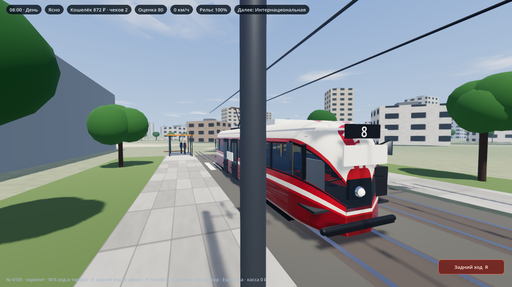
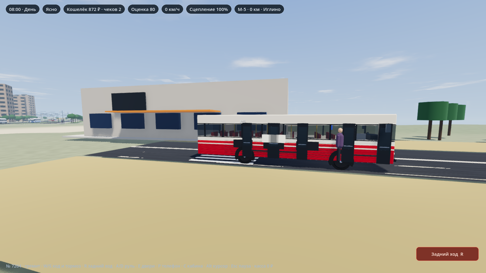
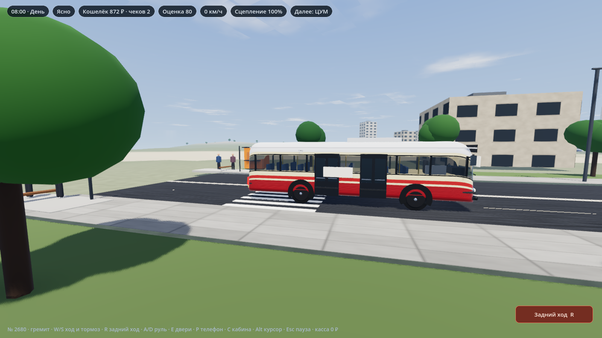
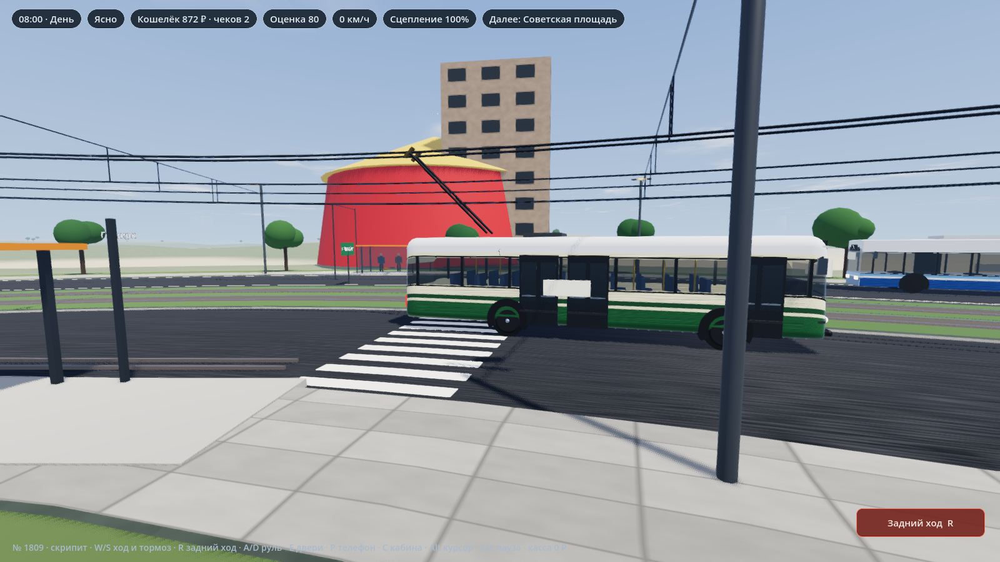
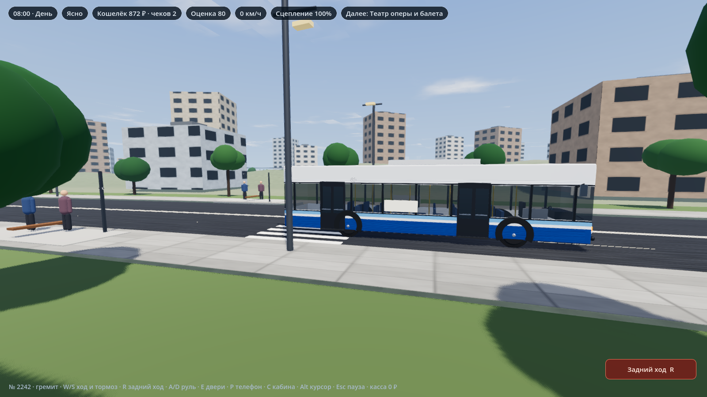
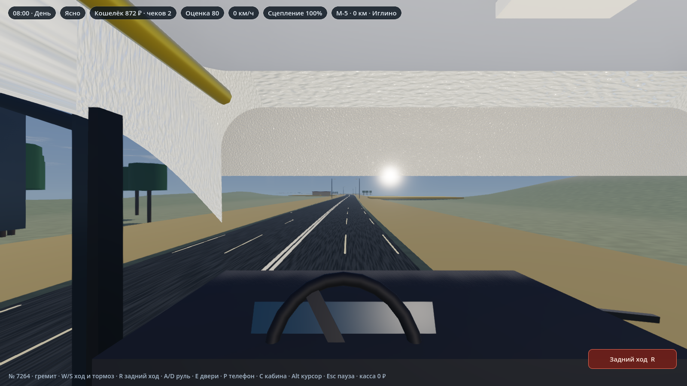
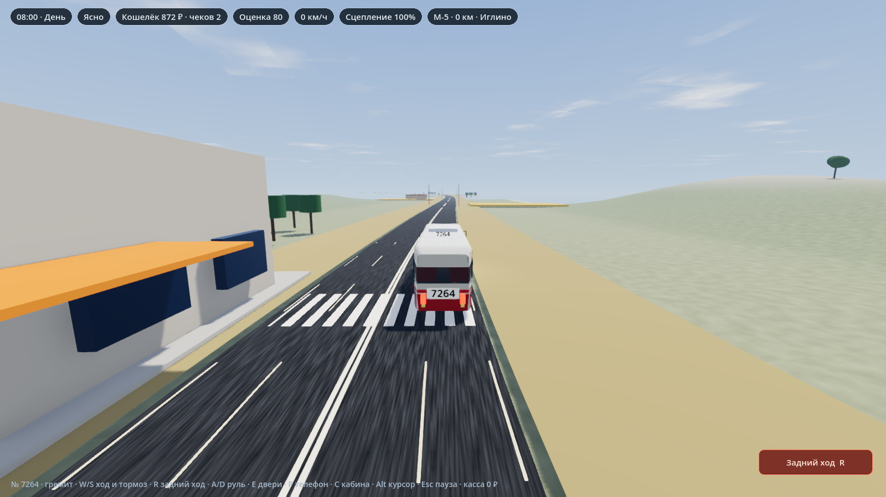
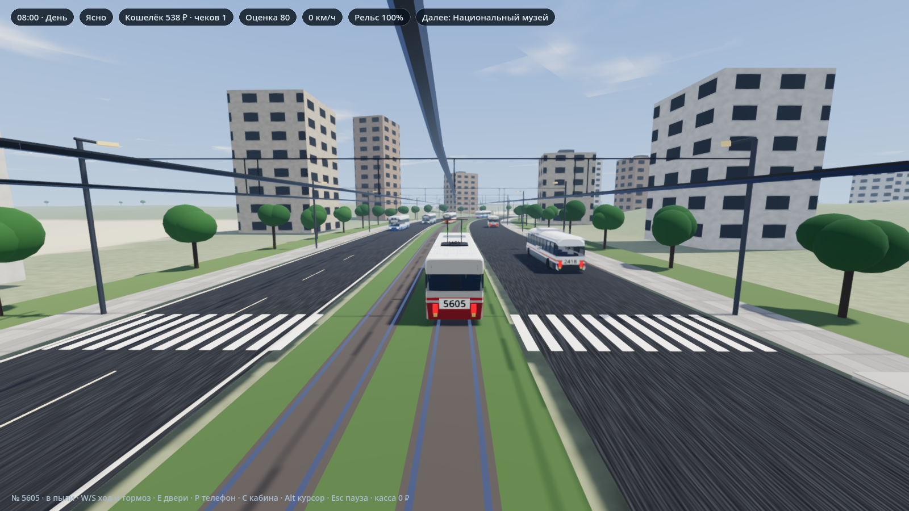
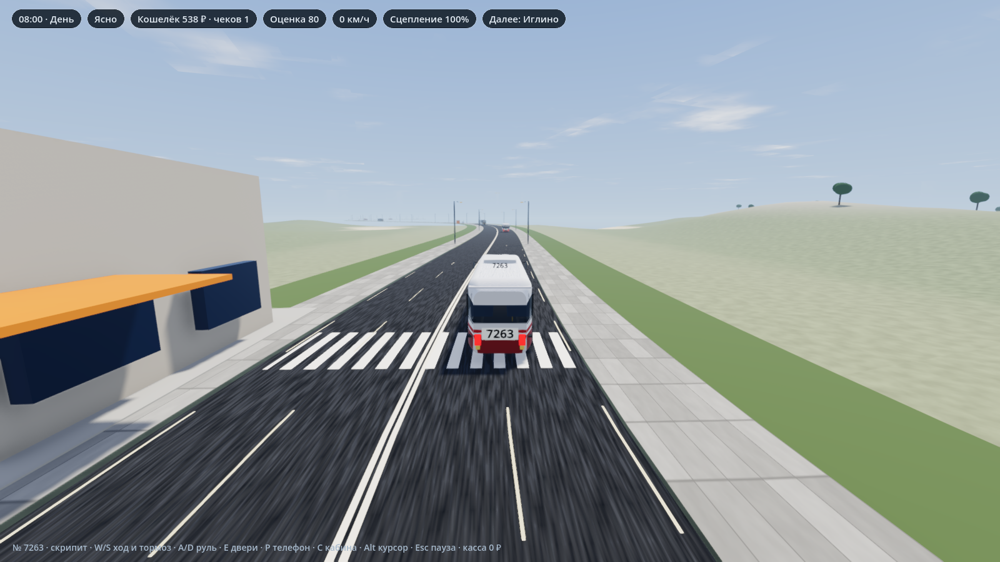

# Уфа: транспорт

Смена начинается у остановки. За стеклом — проспект, провода и чужой борт в соседнем ряду. Дождь удлиняет тормозной путь, ночью фары сами загораются, а если взять Икарус на М-5, впереди сто двадцать километров до Стерлитамака: пшеница, кафе, пост ДПС и обратный рейс.

Это симулятор городского и междугороднего транспорта. Можно сесть за руль самому или встать директором депо: нанять водителей, купить машины и открыть новый рейс.

## Как это ощущается

- **Город, а не один круг.** Центр с башнями, спальные панели, автовокзал, промзона, дачи у аэропорта и трасса за город.
- **Свой борт.** Икарус-260, ЛиАЗ-677, НефАЗ, ГАЗель, ЗиУ-9, КТМ-5, Tatra T3, Pesa и остальные машины парка собраны по заводским размерам: плоская морда Икаруса, шлем Татры с одной фарой, «бульдог» ЛиАЗа-677.
- **Погода меняет езду.** В дождь тормоза слабее, в снег все едут медленнее, в тумане дорога пропадает примерно на сотне метров.
- **Касса и депо.** Городской билет, пригород, межгород, льгота и проездной. Директор считает выручку, зарплату и топливо.
- **Рейс Уфа — Стерлитамак.** Посадка десять минут, остановки по трассе, кафе на середине пути, кондуктор, ночной рейс и зимний рейс.

## Управление

| Клавиша | Что делает |
| --- | --- |
| W / S или стрелки | Газ и тормоз. Назад — только после остановки |
| A / D | Руль |
| R или кнопка «Задний ход» | Задняя передача |
| E | Двери |
| C | Кабина |
| Пробел | Звонок |
| P | Телефон: отзыв пассажира |
| Alt | Курсор |
| Esc | Пауза |

Пассажир ходит к остановке пешком и садится у зебры.

## Маршруты

Сеть сжатая и игровая: знакомые уфимские имена, но не официальное расписание.

### Автобус

| № | Куда | Остановки | Машины | Кто возит |
| --- | --- | --- | --- | --- |
| 30 | Зелёная Роща — Ж/д вокзал | Зелёная Роща, Менделеева, Госцирк, Советская площадь, Гостиный двор, Национальный музей, Ж/д вокзал | Вектор NEXT, НефАЗ-5299, ЛиАЗ-5292, ЛиАЗ-677 | Башавтотранс |
| 57 | Санаторий — Дзержинского | Санаторий «Зелёная Роща», ЦУМ, Театр оперы и балета, Проспект Салавата, Дзержинского | те же городские | Башавтотранс, спальный район |
| 15 | Спальный — Дзержинского | те же, что у 57 | ГАЗель NEXT, Ford Transit, ПАЗ-3205 | частный перевозчик |
| 69 | ЦУМ — Дзержинского | ЦУМ, Театр оперы и балета, Проспект Салавата, Дзержинского | Вектор NEXT, НефАЗ-5299 | Башавтотранс |
| 74 | Госцирк — Ж/д вокзал | Госцирк, Советская площадь, Гостиный двор, Национальный музей, Ж/д вокзал | городские автобусы | Башавтотранс |
| 25 | Госцирк — Национальный музей | Госцирк, Советская площадь, Гостиный двор, Национальный музей | ГАЗель NEXT, Ford Transit, ПАЗ-3205 | частный, вечером не ходит |
| 101 | Дзержинского — Аэропорт | Дзержинского, Южный автовокзал, Мост через Белую, Посёлок Аэропорт, Аэропорт | Yutong, ГАЗель NEXT, Ford Transit, ПАЗ-3206 | пригород |

### Троллейбус

| № | Куда | Остановки | Машины |
| --- | --- | --- | --- |
| 1 | Госцирк — Ж/д вокзал | Госцирк, Советская площадь, Гостиный двор, Национальный музей, Ж/д вокзал | Горожанин, БТЗ-52011, ЗиУ-682, ЗиУ-9 |
| 13 | Зелёная Роща — Ж/д вокзал | весь проспект | УТТЗ-6243 «Гармошка», Горожанин |
| 22 | Менделеева — Гостиный двор | Менделеева, Госцирк, Советская площадь, Гостиный двор | Горожанин, БТЗ-52011, ЗиУ-682, ЗиУ-9 |

### Трамвай

| № | Куда | Остановки | Машины |
| --- | --- | --- | --- |
| 18 | Зелёная Роща — Госцирк | Зелёная Роща, Менделеева, Госцирк | Pesa Fokstrot |
| 5 | Зелёная Роща — Ж/д вокзал | весь проспект | Pesa Fokstrot |
| 1 | Гостиный двор — Ж/д вокзал | Гостиный двор, Национальный музей, Ж/д вокзал | КТМ-608, КТМ-619, КТМ-623, КТМ-5 |
| 10 | Советская площадь — Ж/д вокзал | Советская площадь, Гостиный двор, Национальный музей, Ж/д вокзал | КТМ-608, КТМ-619, КТМ-623, КТМ-5 |
| 16 | Менделеева — Советская площадь | Менделеева, Госцирк, Советская площадь | КТМ-608, КТМ-619 |
| 6 | Интернациональная — Гастелло | Интернациональная, Улица Трамвайная, Стадион Гастелло | Tatra T3, Tatra T3M, МТТЧ |
| 8 | Депо Черниковки — Гастелло | Депо Черниковки, Интернациональная, Улица Трамвайная, Стадион Гастелло | Tatra T3, Tatra T3M, МТТЧ |

### М-5 и промзона

| № | Куда | Остановки | Машины | Заметка |
| --- | --- | --- | --- | --- |
| 501 | Уфа — Стерлитамак | Автовокзал, Иглино, Кафе «М-5», Зирган, Стерлитамак | Икарус-260 | билет 500 ₽ |
| 502 | Уфа — Салават | те же и Салават | Икарус-260, Yutong | билет 500 ₽ |
| 503 | Уфа — Октябрьский | те же, Салават и Октябрьский | Икарус-260, Yutong | маршрут надо построить за 480 000 ₽ |
| 4 | Промзона — Карьер | Промзона, Склад, Цех, Карьер | ПАЗ-3206, ПАЗ-3205 | грузовая смена |

На 501 полный салон приносит около 20 000 ₽. Топливо и кондуктор съедают часть, на руках остаётся прибыль рейса. Два рейса в день уже кормят депо, а сотня рейсов — отдельная полка достижений.

## Запуск

Нужен [Godot 4.7](https://godotengine.org/). Открой папку `godot` как проект и нажми Play.

Готовый exe в репозиторий не входит: собери его из Godot или скриптом `tools/build-exe.ps1`, если редактор уже стоит.
